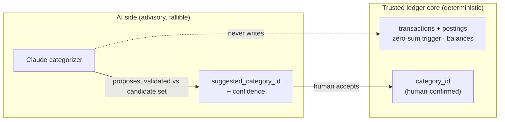
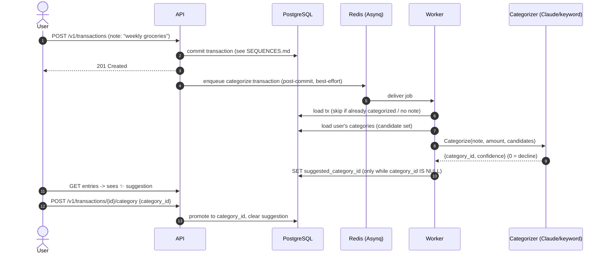

# LedgerX — AI Transaction Categorization

LedgerX uses an LLM (Claude) to suggest which category a transaction belongs
to. This document explains the one design rule that makes it safe, how the flow
runs, and how the feature is measured.

## The one rule: AI stays outside the correctness boundary

A ledger's whole value is that its numbers are trustworthy. So the AI is not
allowed anywhere near them. Concretely:

- The model **never** computes money, writes a posting, or touches a balance.
- The model **only proposes** a category id, chosen from a closed set of the
  user's existing categories. Its output is validated against that set before
  being stored — it cannot name a category that doesn't exist.
- That proposal lands in `transactions.suggested_category_id` (+ a confidence
  score). The authoritative `category_id` is set **only by a human
  confirmation** (`POST /v1/transactions/{id}/category`).
- The double-entry invariants (zero-sum trigger, idempotency, immutability) are
  completely untouched by categorization.



If the model is wrong, the worst case is a bad *suggestion* the user declines —
the ledger is never corrupted.

## Flow

Categorization is asynchronous so the model's latency never blocks transaction
creation. It reuses the existing Asynq worker and is wired through the
transaction service's optional `CategorizeEnqueuer` (best-effort, post-commit).



Two safety details fall out of the SQL:

- `SetCategorySuggestion` has `WHERE category_id IS NULL`, so a late job can
  never overwrite a human confirmation.
- The enqueue uses a per-transaction Asynq `TaskID`, so retries/re-enqueues
  don't pile up duplicate jobs.

## Pluggable backends

The `ai.Categorizer` interface has two implementations, selected by env
(`internal/ai/factory.go`):

| Backend | When | Notes |
| --- | --- | --- |
| `ClaudeCategorizer` | `ANTHROPIC_API_KEY` set | Forced tool use (`tool_choice: categorize`) → always a structured `{category_id, confidence}`. Model via `CATEGORIZER_MODEL` (default `claude-haiku-4-5` — the right tier for high-volume classification). |
| `KeywordCategorizer` | no key, or `CATEGORIZER=keyword` | Dependency-free word-boundary match on category names. The deterministic baseline and offline/dev fallback. |

The app runs and the feature degrades gracefully with no API key — useful for
local dev and CI, and it's what the tests and the default eval run against.

## Evals — how the feature is measured

The classifier is only as good as its accuracy on real examples, so the
deliverable is an **eval harness**, not just the classifier. A labelled golden
set lives at `internal/ai/testdata/categorize_golden.jsonl` (one
`{note, amount, candidates, want_id}` per line). `ai.Evaluate` scores any
`Categorizer` against it.

Run it:

```sh
# deterministic baseline (no key)
CATEGORIZER=keyword go run ./cmd/categorize-eval -v

# the Claude categorizer
ANTHROPIC_API_KEY=... go run ./cmd/categorize-eval
```

The keyword baseline scores ~58% on the current set — and the harness prints
exactly which cases it misses (the semantic ones like "Uber to the airport" →
Transport). That gap is the headroom the LLM is meant to close, and re-running
the eval after a prompt or model change is how you catch a regression before it
ships. `TestEvalHarnessOnKeywordBaseline` pins the baseline into a band so the
harness itself is regression-tested in CI.

## Schema

See [DATA_MODEL.md](./DATA_MODEL.md) for the full ERD. The categorization-
specific columns (migration 0014) are:

- `transactions.suggested_category_id` → `categories(id)` — the AI proposal.
- `transactions.suggestion_score` (double precision, 0..1) — model confidence.
- `categories(user_id, lower(name))` unique index — clean candidate set.
