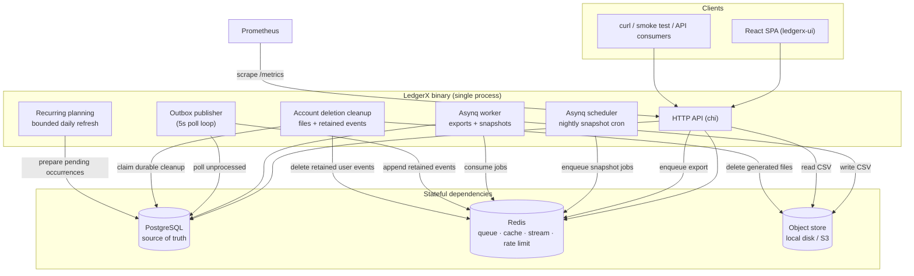
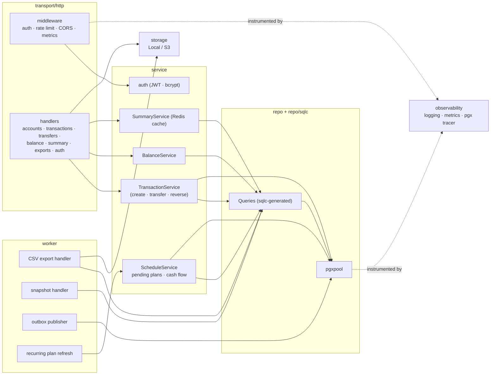
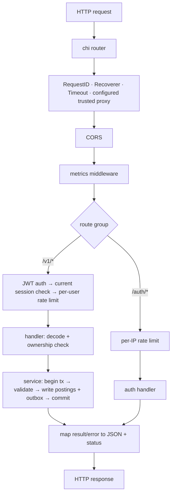

# LedgerX — Architecture

LedgerX is a double-entry accounting backend written in Go, with a React/Vite
frontend. This document covers the system context, the internal component
layering, the runtime processes, and the lifecycle of a request. For the
database schema see [DATA_MODEL.md](./DATA_MODEL.md); for the per-flow
sequence diagrams see [SEQUENCES.md](./SEQUENCES.md); for the endpoint list see
[API.md](./API.md).

## System context

The whole backend ships as a **single Go binary** that runs an HTTP API and
five background components in-process. It depends on PostgreSQL (source of
truth), Redis (job queue, cache, rate-limit buckets, event stream), and an
object store for export files (local disk in dev, S3-compatible in production).

## Component layering

Transport calls services for financial writes and workflows; some simple reads
call repository queries directly. Services own transaction boundaries and use
SQLC queries plus feature-specific inline SQL through pgx. Workers use repository
queries or shared planning services. No service depends on HTTP or a worker.
Moving inline SQL into feature repository queries is incremental engineering
work, not an already-completed boundary. See [ENGINEERING_REVIEW.md](ENGINEERING_REVIEW.md).

### Layer responsibilities

| Layer | Package | Responsibility |
| --- | --- | --- |
| Transport | `internal/transport/http` | HTTP decoding/encoding, auth & rate-limit middleware, ownership checks, mapping service errors to status codes. No business rules. |
| Service | `internal/service` | Business rules, exact-money arithmetic and transaction boundaries. Direct writes, imports, plans, corrections and recovery serialize through the per-user ledger lock; postings and outbox commit atomically. |
| Repository | `internal/repo`, `internal/repo/sqlc` | `pgxpool`, SQLC query methods and small custom streaming/bulk adapters. SQLC sources live in `internal/repo/queries/*.sql`; some newer feature SQL remains inline in services. |
| Worker | `internal/worker` | Asynq exports/snapshots/category suggestions; outbox publishing, privacy cleanup and pending recurring-plan refresh. |
| Storage | `internal/storage` | `Storage` interface with `Local` (disk) and `S3` implementations, selected by `EXPORT_STORAGE`. |
| Observability | `internal/observability` | zap logger, Prometheus HTTP/DB metrics, and a `pgx.Tracer` that times every query. |

## Runtime processes

`cmd/ledgerx/main.go` initializes dependencies and launches six concurrent units, then
blocks until a signal or a fatal component error.

| Unit | Trigger | Work |
| --- | --- | --- |
| HTTP API | inbound requests | Serves `/auth/*`, `/v1/*`, `/healthz`, `/readyz`, `/metrics`. |
| Asynq worker | jobs on Redis | Generates CSV exports, balance snapshots and advisory category suggestions. |
| Asynq scheduler | cron `5 0 * * *` UTC | Enqueues the nightly "snapshot all accounts" fan-out job. |
| Outbox publisher | 5s ticker | Appends committed `outbox` rows to the `events:ledger` Redis Stream, then marks them processed. |
| Privacy cleanup | 5s ticker | Retries queued export-object deletion and retained-event removal after an account is deleted. |
| Recurring planning | startup and 1min ticker | Refreshes up to 100 due users per batch, preparing pending occurrences 90 days ahead. Never posts money automatically. |

With `UI_DIR` configured, the HTTP process also serves the built SPA. The complete
app package builds it, runs migrations first, and persists local exports. Pool
sizes and worker concurrency are configurable; roles still share one process.
Protected API calls also check the user's database credential generation to
invalidate access after password changes/recovery or deletion. See
[account security](./ACCOUNT_SECURITY.md), [packaging](./RUNNING_AND_DEPLOYMENT.md),
and the [local scalability baseline](./SCALABILITY_BASELINE.md).

### Event consumers

The publisher uses `XADD events:ledger *` with `outbox_id`, `event_type`, and
JSON `payload` fields. Events remain available when no consumer is connected.
The publisher marks an outbox row processed only after Redis acknowledges the
append; a failed append leaves it available for a later batch.

A crash after the append and before the PostgreSQL commit can create duplicate
stream entries. Consumers must deduplicate by the stable `outbox_id`, rather
than the Redis stream entry ID. Create each consumer group at `0` to include
retained history, read with `XREADGROUP`, and `XACK` only after committing the
side effect and deduplication record together. Recover abandoned pending
entries with `XAUTOCLAIM` after a consumer failure. Each independent consumer
needs its own group. LedgerX provides the retained stream; downstream consumer
group handlers are outside this application.

The application does not trim this stream. Operators may trim only after all
required consumers have processed the affected entries. Redis persistence and
backups must match deployment durability requirements: the Compose setup uses
AOF with Redis's default `appendfsync everysec`, which can lose recent writes
after a Redis host failure. Stream retention protects against consumer downtime;
an `XADD` acknowledgement alone does not guarantee an fsync or replica quorum.

### Graceful shutdown

SIGINT/SIGTERM or a component failure cancels the root context. HTTP gets a 10s
drain; if that deadline fails, active connections are closed. The three
context-driven loops are joined before shared database/Redis clients close.
The Asynq worker/scheduler and HTTP task producers also close during deferred
cleanup. Runtime component failures use an error channel so this cleanup runs.
The server limits header/body reads and idle connections while preserving the
longer import request timeout.

## Request lifecycle (write path)

## Technology choices

| Concern | Choice | Why |
| --- | --- | --- |
| Language | Go | Single static binary, strong concurrency, simple deploys. |
| HTTP router | chi v5 | Routing and middleware built on `net/http`. |
| Database | PostgreSQL | Transactions, constraint triggers, `FOR UPDATE SKIP LOCKED` — the features the ledger invariants and outbox rely on. |
| DB access | pgx v5 + sqlc | Generated, type-checked Go methods from SQL queries. |
| Background jobs | Asynq (Redis) | Redis-backed job processing with at-least-once delivery and scheduling. |
| Migrations | golang-migrate | Versioned up/down SQL migrations. |
| Auth | JWT (HS256) + bcrypt | JWT access tokens checked against credential generation; bcrypt password hashes. |
| Metrics | Prometheus | Standard pull-based metrics for HTTP and DB. |
| Frontend | React + Vite + TanStack Query | Fast dev loop, server-state caching, typed API client. |
