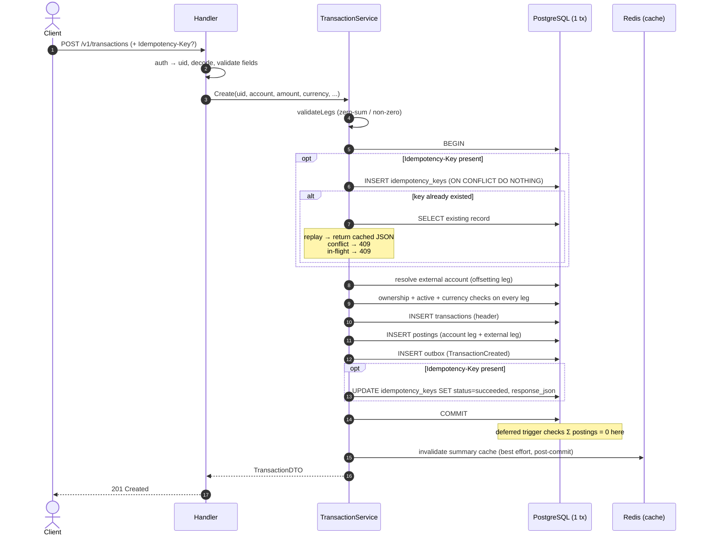
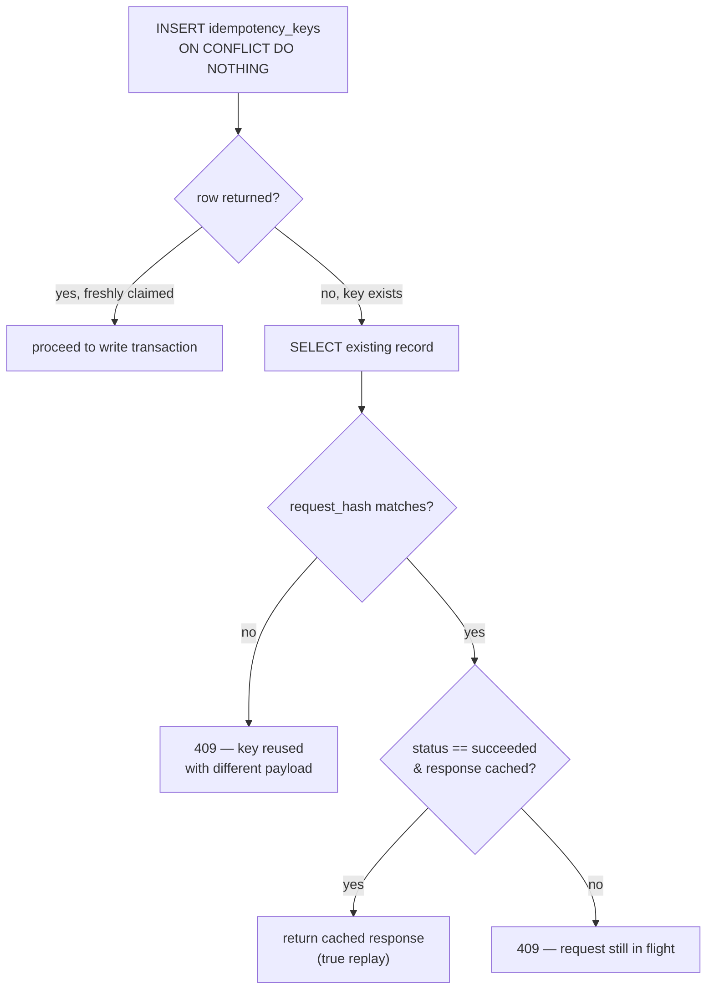
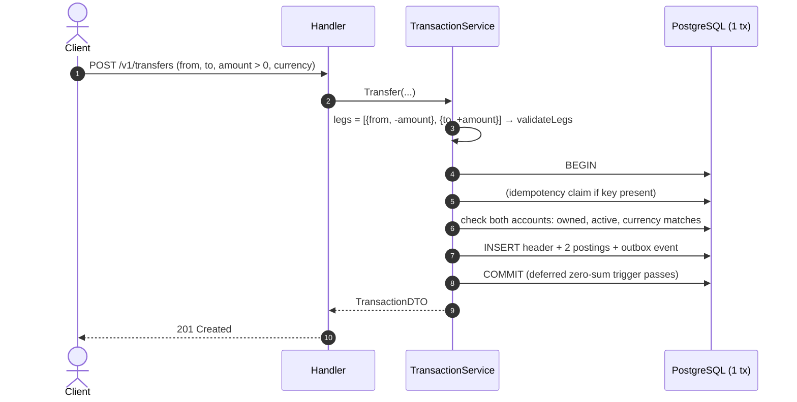
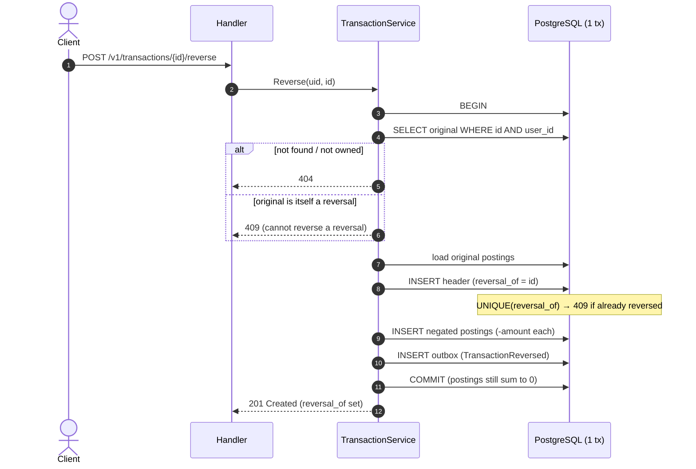
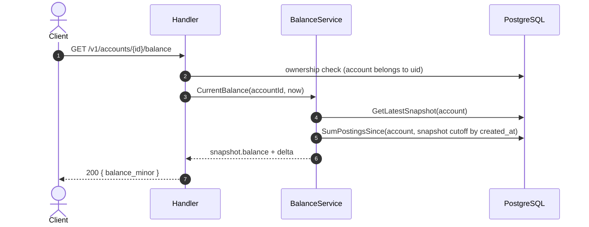
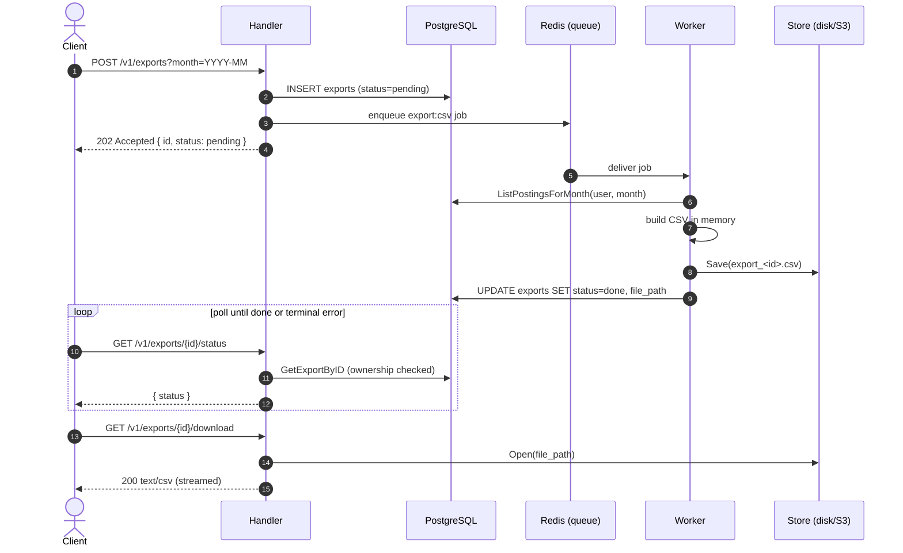
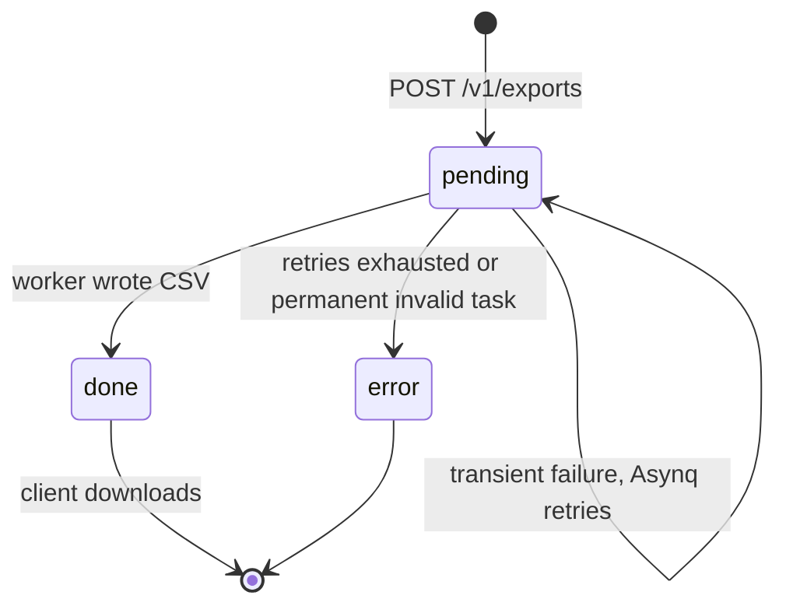
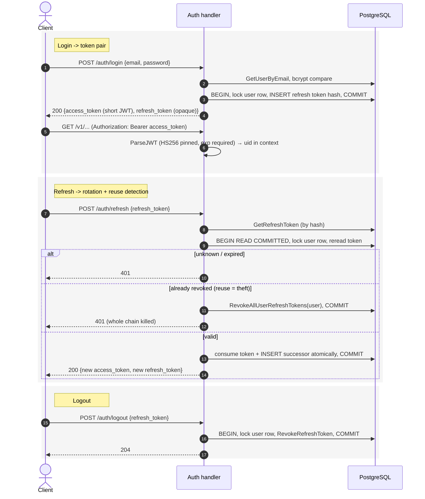

# LedgerX — Sequence & Flow Diagrams

How the key flows actually execute at runtime. For the static structure see
[ARCHITECTURE.md](./ARCHITECTURE.md); for the schema and invariants see
[DATA_MODEL.md](./DATA_MODEL.md).

Participants are abbreviated: **H** = HTTP handler, **Svc** =
`TransactionService`, **PG** = PostgreSQL (inside one DB transaction unless
noted), **Redis**, **Worker** = Asynq worker, **Store** = export storage.

---

## 1. Create transaction (idempotent, with outbox)

The single most important flow. Everything from the idempotency claim to the
outbox event commits in **one DB transaction**, so the system can never end up
with a transaction but no event, or a charged key but no transaction.



## 2. Idempotency decision logic

What happens when the key is claimed (step "key already existed" above),
broken out because the branching is the subtle part.



## 3. Transfer between accounts

Same engine as create, but the legs are supplied explicitly and already sum to
zero, so **no external account is involved**. Ownership and matching currency
are checked on both legs.



## 4. Reversal (append-only correction)



## 5. Balance read (snapshot + delta)

A read path, no DB transaction needed. See the formula in
[DATA_MODEL.md](./DATA_MODEL.md#balances-snapshot--delta-cut-on-created_at).



## 6. Asynchronous CSV export

Request and generation are decoupled through the Asynq queue; the client polls
status and downloads through the authenticated API (so the file's location —
disk or S3 — is invisible to the client).



### Export status state machine



## 7. Outbox publisher

Runs every 5 seconds. Claims a batch **inside a transaction** so
`FOR UPDATE SKIP LOCKED` holds the locks until commit — concurrent publishers
get disjoint batches. Events are appended to the retained `events:ledger`
Redis Stream, so consumers can reconnect and read events created while they
were offline. A crash after append but before PostgreSQL commit can append
again; duplicate entries carry the same `outbox_id`.

```mermaid
sequenceDiagram
    autonumber
    participant OB as Outbox publisher
    participant PG as PostgreSQL (1 tx)
    participant R as Redis Stream
    participant C as Downstream consumer group

    loop every 5s
        OB->>PG: BEGIN
        OB->>PG: SELECT ... WHERE processed_at IS NULL<br/>ORDER BY created_at LIMIT 50<br/>FOR UPDATE SKIP LOCKED
        loop each event
            OB->>R: XADD events:ledger *<br/>outbox_id, event_type, payload
            R-->>OB: stream entry ID (append acknowledged)
        end
        OB->>PG: UPDATE outbox SET processed_at = now()<br/>WHERE id = ANY(appended)
        OB->>PG: COMMIT
    end

    Note over R,C: Group starts at 0 to include retained history;<br/>consumer may connect after publication
    C->>R: XREADGROUP ... STREAMS events:ledger >
    R-->>C: retained event (outbox_id, type, payload)
    C->>C: commit side effect + dedupe outbox_id
    C->>R: XACK events:ledger group entry-id
```

Only successful appends are marked processed. Consumers acknowledge after their
own durable work and recover abandoned pending entries with `XAUTOCLAIM`.
There is no automatic stream trimming. Redis persistence and replication remain
deployment responsibilities; see [event consumers](./ARCHITECTURE.md#event-consumers)
for the fsync and retention limits.

## 8. Authentication



Register follows the same shape as login (validate → bcrypt → insert user →
issue a token pair). `/auth/*` is rate-limited **per IP** (anti
credential-stuffing); `/v1/*` is rate-limited **per user**. Both fail **closed**
(HTTP 503) if the limiter's Redis is unreachable, so an outage can never
silently disable the limit.

All token writes use the same user-row lock. A refresh waiting behind reuse
revocation rereads the now-revoked token before deciding whether to rotate.
If a descendant rotation holds the lock first, its successor commits before
reuse revocation takes a fresh snapshot and revokes every active token.
